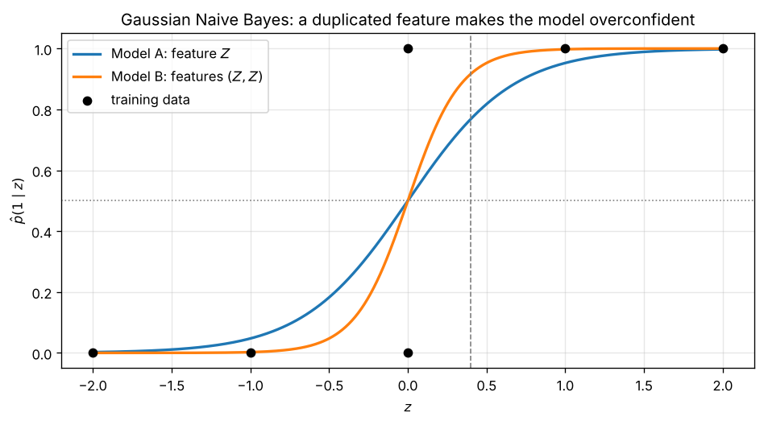
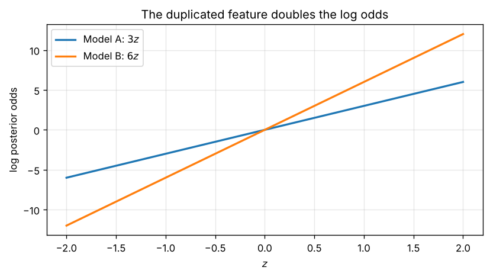
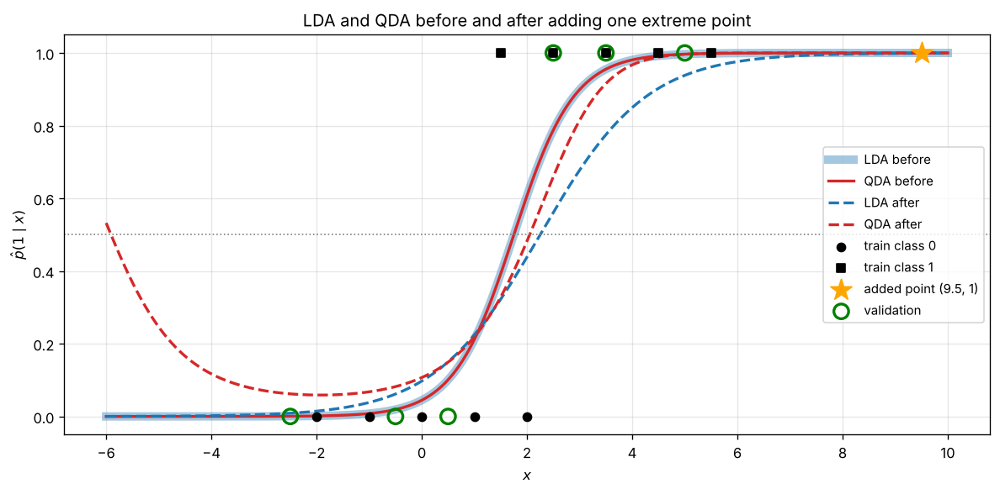

# Generative Classifiers: How Assumptions Shape Confidence

[](https://github.com/Nobleteesage/Generative-classifiers-nb-lda-qda/actions/workflows/tests.yml)
[](https://colab.research.google.com/github/Nobleteesage/Generative-classifiers-nb-lda-qda/blob/main/notebooks/HW4B_Generative_Classification.ipynb)


A small, fully reproducible study of three **generative Gaussian classifiers** (Gaussian Naive Bayes, Linear Discriminant Analysis and Quadratic Discriminant Analysis), built around two questions:

1. **Naive Bayes:** what happens to the predicted probabilities when the same feature is given to the model twice?
2. **LDA vs QDA:** how does a single extreme observation change each model, and why do they react so differently?

The project was developed as Homework 4B for the course *Machine Learning: Mathematical Basis* (D.B. Rokhlin, 2026) in the MSc programme Applied Mathematics and Informatics at Southern Federal University, and extended here into a standalone repository with reusable code, tests and reproducible figures.

---

## Table of contents

* [Background](#background)
* [Experiment 1: Naive Bayes with a duplicated feature](#experiment-1-naive-bayes-with-a-duplicated-feature)
* [Experiment 2: LDA and QDA with one extreme observation](#experiment-2-lda-and-qda-with-one-extreme-observation)
* [Key takeaways](#key-takeaways)
* [Repository structure](#repository-structure)
* [How to reproduce](#how-to-reproduce)
* [Author](#author)

---

## Background

A generative classifier models how the data are produced in each class, then inverts that model with Bayes' formula:

$$
\hat p(k \mid x) = \frac{\hat\pi_k\, p_{\hat\eta_k}(x)}{\sum_j \hat\pi_j\, p_{\hat\eta_j}(x)} .
$$

For two classes it is convenient to look at the **log posterior odds**

$$
\log\frac{\hat p(1\mid x)}{\hat p(0\mid x)} = \log\frac{\hat\pi_1}{\hat\pi_0} + \log\frac{p_{\hat\eta_1}(x)}{p_{\hat\eta_0}(x)},
$$

which is $0$ on the decision boundary and grows as the model becomes more confident. The three models differ only in what they assume about $p_{\eta_k}(x)$:

| Model | Class conditional density | Shape of the log odds |
|---|---|---|
| Gaussian Naive Bayes | independent Gaussian per feature, $\prod_j \mathcal N(x_j;\mu_{kj},\sigma^2_{kj})$ | sum of one term per feature |
| LDA | $\mathcal N(\mu_k, \Sigma)$ with a **shared** covariance | linear in $x$ |
| QDA | $\mathcal N(\mu_k, \Sigma_k)$ with a **separate** covariance per class | quadratic in $x$ |

---

## Experiment 1: Naive Bayes with a duplicated feature

### Setup

Training data: $Z = (-2, -1, 0, 0, 1, 2)$ with labels $Y = (0, 0, 0, 1, 1, 1)$.

* **Model A** uses the single feature $Z$.
* **Model B** uses two features $(Z, Z)$: an exact copy, so no new information.

Both are fitted with `sklearn.naive_bayes.GaussianNB`.

### Results

The fitted parameters are the same in both models: $\hat\mu_0 = -1$, $\hat\mu_1 = 1$, $\hat\sigma^2 = 2/3$ for every feature, and $\hat\pi_0 = \hat\pi_1 = 1/2$. This gives

$$
\log\text{odds}_A(z) = \frac{(z+1)^2 - (z-1)^2}{2 \cdot 2/3} = 3z, \qquad \log\text{odds}_B(z) = 6z .
$$

| Model | Log odds at $z = 0.4$ | $\hat p(1 \mid z = 0.4)$ |
|---|---|---|
| A: $Z$ | 1.2 | **0.7685** |
| B: $(Z, Z)$ | 2.4 | **0.9168** |





### Interpretation

* Naive Bayes assumes the features are **conditionally independent given the class**, so the log odds are a sum of one log likelihood ratio per feature. The copy of $Z$ contributes exactly the same term again, and because the priors are equal the prior term is $\log 1 = 0$. Hence the log odds double: $\log\text{odds}_B = 2 \log\text{odds}_A$ for every $z$ (verified numerically to machine precision).
* Both curves cross $0.5$ at $z = 0$, so the **class decisions are identical**. Only the probabilities change: Model B is pushed towards $0$ and $1$.
* The same evidence is counted twice, so Model B is **overconfident**. Log loss would punish it heavily for any mistake. Correlated or duplicated features are a well known weakness of Naive Bayes.

---

## Experiment 2: LDA and QDA with one extreme observation

### Setup

| | values |
|---|---|
| Class 0 training points | −2, −1, 0, 1, 2 |
| Class 1 training points | 1.5, 2.5, 3.5, 4.5, 5.5 |
| Validation $x$ | −2.5, −0.5, 0.5, 2.5, 3.5, 5 |
| Validation $y$ | 0, 0, 0, 1, 1, 1 |
| Extra observation | $(x, y) = (9.5, 1)$ |

LDA and QDA are fitted with scikit-learn, fixed priors $\pi_0 = \pi_1 = 1/2$, before and after adding the extra observation.

### Results

| Model | Data | $\hat\mu_0$ | $\hat\mu_1$ | $\hat\sigma_0^2$ | $\hat\sigma_1^2$ | Decision boundaries | Validation log loss |
|---|---|---|---|---|---|---|---|
| LDA | before | 0 | 3.5 | 2.000 | 2.000 | 1.75 | 0.0689 |
| QDA | before | 0 | 3.5 | 2.000 | 2.000 | 1.75 | 0.0689 |
| LDA | after | 0 | 4.5 | 4.545 | 4.545 | 2.25 | 0.1885 |
| QDA | after | 0 | 4.5 | 2.000 | 6.667 | **−5.91** and 2.05 | **0.1366** |



### Interpretation

* **Before the addition** both classes have the same spread, so the QDA variances are equal and **QDA reduces to LDA**: identical curves, boundary at the midpoint $1.75$, identical log loss.
* **The extra point** at $9.5$ moves the class 1 mean from $3.5$ to $4.5$ and, more importantly, inflates the class 1 spread: its squared deviation $(9.5 - 4.5)^2 = 25$ exceeds all other class 1 deviations combined ($15$).
* **LDA** must share one variance, so the class 1 problem is spread over both classes and $\hat\sigma^2$ more than doubles. The boundary shifts to the new midpoint $2.25$, the slope $(\hat\mu_1 - \hat\mu_0)/\hat\sigma^2$ drops, and the whole curve becomes flatter. The validation point $x = 2.5$ falls to $\hat p = 0.56$, and the log loss nearly triples.
* **QDA** keeps $\hat\sigma_0^2$ unchanged and only inflates $\hat\sigma_1^2$ (more than threefold). Class 0 stays sharp, so QDA remains confident near the class 0 data, and its log loss rises much less than LDA's.
* **The price QDA pays:** with $\hat\sigma_1^2 > \hat\sigma_0^2$ the $x^2$ coefficient of the log odds, $\tfrac{1}{2\hat\sigma_0^2} - \tfrac{1}{2\hat\sigma_1^2}$, is positive. The log odds become an upward parabola, so $\hat p(1 \mid x) \to 1$ in **both** tails. A second decision boundary appears near $x \approx -6$, far from any class 1 data. It is an artifact of Gaussian tails, not of the data.

> Note on scikit-learn versions. scikit-learn 1.9 and later estimate variances with the divisor $n$ (maximum likelihood, as in the lecture). Older versions use $n - 1$ for QDA and $n - K$ for LDA. With an older version the Experiment 2 numbers change slightly (log losses 0.0997, 0.2250, 0.1782; QDA boundaries −6.24 and 2.15), but every conclusion above is the same. The test suite only checks version independent properties.

---

## Key takeaways

1. **Assumptions decide confidence.** Naive Bayes doubled its log odds on information it had already seen, because its independence assumption told it to.
2. **Shared vs separate parameters is a trade off.** LDA's shared variance lets one outlier affect the whole model. QDA contains the damage, but its extra flexibility creates artifacts far from the data.
3. **Plot the probabilities, not just the decisions.** Both experiments leave most class decisions unchanged; the real story is in the probability curves.

---

## Repository structure

```
generative-classifiers-nb-lda-qda/
├── notebooks/
│   └── HW4B_Generative_Classification.ipynb   # executed notebook with derivations, code and plots
├── src/
│   ├── __init__.py
│   └── generative_models.py                   # reusable model, metric and boundary functions
├── tests/
│   └── test_generative_models.py              # checks against hand derived values
├── figures/                                   # generated by run_experiments.py
│   ├── nb_probabilities.png
│   ├── nb_log_odds.png
│   └── lda_qda_curves.png
├── results/                                   # generated by run_experiments.py
│   ├── naive_bayes.csv
│   ├── lda_qda_summary.csv
│   └── lda_qda_validation_predictions.csv
├── .github/workflows/tests.yml                # runs the tests on every push
├── run_experiments.py                         # reproduces every number and figure in this README
├── requirements.txt
├── pytest.ini
├── LICENSE
└── README.md
```

---

## How to reproduce

**Option 1: in the browser.** Click the *Open in Colab* badge at the top and choose *Runtime → Run all*.

**Option 2: locally** (Python 3.11 or newer).

```bash
git clone https://github.com/Nobleteesage/Generative-classifiers-nb-lda-qda.git
cd Generative-classifiers-nb-lda-qda
python -m venv .venv
source .venv/bin/activate          # on Windows: .venv\Scripts\activate
pip install -r requirements.txt

python run_experiments.py          # regenerates figures/ and results/
python -m pytest                   # runs the test suite
jupyter notebook notebooks/        # optional: open the notebook
```

All computations are deterministic.

---

## Author

**Goriola-Obafemi Babatunde Sukanmi**
MSc Applied Mathematics and Informatics (Modern Software Development), 

* GitHub: [@Nobleteesage](https://github.com/Nobleteesage)
* ORCID: [0009-0000-2865-5242](https://orcid.org/0009-0000-2865-5242)

## Related project

* [conditional-models-logloss](https://github.com/Nobleteesage/conditional-models-logloss): discriminative conditional models (Gaussian regression and logistic regression) evaluated with log loss.

## Acknowledgements

Problem formulation from Homework 4B of *Machine Learning: Mathematical Basis* by D.B. Rokhlin 

## License

Released under the [MIT License](LICENSE).
